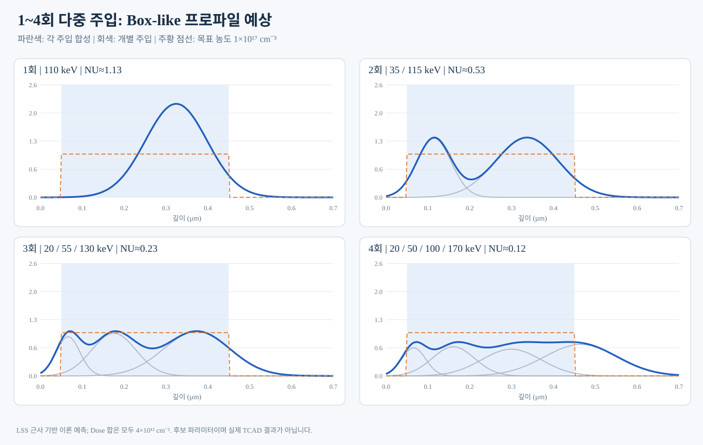
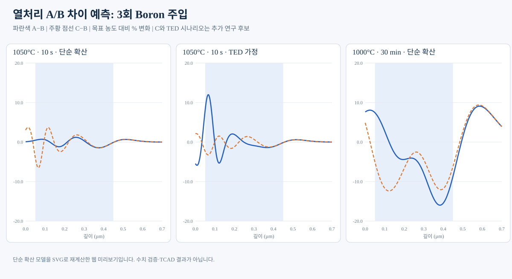

# 다중 에너지 Boron 주입 Box Profile — TCAD 실행 전 사전 자료조사

작성일: 2026-11-18

| 폴더·파일 | 내용 |
|---|---|
| `analysis/box_tools.py` | 지표 계산, Dose·에너지 최적화, 중첩 확인, 열처리 시퀀스 예측 (LSS 모델 또는 TCAD 출력 파일) |
| `analysis/designs_lss.json` | LSS 모델 기준 회차별 최적 설계 (2-4) |
| `analysis/make_figures.py` → `figures/` | 이 문서의 그림 |
| `tcad/make_decks.py` → `tcad/decks/`, `tcad/run_list.csv` | Sentaurus Process 1D 입력 파일 46개와 실행 목록 (6장) |
| `box_check.py`, `box_check2.py` | 초기 검산 스크립트 (5-1) |

---

## 0. 요약

- 기존 조사 문서의 수치 중 교재·논문에서 직접 온 것은 **Rp/ΔRp 표 하나**다 (20–150 keV는 Gibbons 표와 일치 확인). 목표 깊이·목표 농도·2~4회 Dose는 수업 PDF의 팀 설계값이고, 열처리 조건은 다른 목적의 논문(0.5~2 keV 초저에너지 접합)과 TCAD 튜토리얼 예제에서 가져왔다.
- 이 문서는 각 값을 (a) 교재·논문, (b) 그 값으로 직접 계산한 결과 중 하나로 근거를 다시 잡는다. 근거가 없는 값은 "설계 목표"라고 명시하고, 왜 그 값이 실험 목적에 맞는지를 계산으로 보인다.
- Gaussian(LSS) 중첩으로 미리 계산하면 총 Dose 4×10¹² cm⁻²를 고정했을 때 최소 NU는 1회 1.13 → 2회 0.53 → 3회 0.23 → 4회 0.12로 줄고, 회차가 늘수록 개선 폭이 작아진다 (그림 1).
- 기존 PDF의 4회 에너지(20/50/100/170 keV)는 LSS 모델에서 최적 조합과 같다. Dose 비율만 바꾸면 된다. 3회는 에너지를 30/80/150 → 20/55/130 keV로 바꾸면 NU가 0.37 → 0.23으로 좋아진다.
- **1050°C 10 s RTA에서 "매번 RTA" vs "최종 1회 RTA" 차이는 순수 확산(Fick)만으로는 목표 농도의 약 1–1.5%**다. Plummer 강의노트의 TED 수치(1050°C에서 지속 약 0.1 s, 과포화 약 500배)로 대략적인 TED를 넣으면 9–12%로 커진다 (그림 2). 따라서 3번 실험은 "TED가 시퀀스 차이를 만드는가"라는 검증 가능한 질문이 되고, TCAD damage 모델 on/off로 직접 확인할 수 있다.
- TCAD 실행 전에 할 일의 핵심: 단일 에너지 TCAD 프로파일을 먼저 뽑고, 그 프로파일로 Dose 비율을 오프라인 최적화한 뒤, 다중 주입 TCAD는 그 예측을 검증하는 용도로 돌린다 (6장). 이를 위한 스크립트와 TCAD 입력 파일은 같은 폴더에 있다.

### 팀이 먼저 정해야 할 것

| # | 결정 사항 | 선택지 | 추천 |
|---|---|---|---|
| 1 | 회차 간 비교 시 무엇을 고정할까 | (a) 총 Dose 고정 (팀 계획서) / (b) 구간 평균 농도 1×10¹⁷ 고정 | (a). 두 조건은 동시에 만족이 안 됨 (5-2). NU는 Dose를 같은 배율로 바꿔도 변하지 않으므로 (a)로 비교하고 평균 농도 오차는 따로 보고 |
| 2 | 목표 깊이 | (a) 0.05–0.45 µm (수업 PDF) / (b) 0.5–1.5 µm (실제 retrograde well 깊이) | (a) 유지 + "retrograde well의 축소 모델"로 서술. (b)는 수백 keV~MeV 주입이 필요해 LSS 표·TCAD 표의 범위를 벗어남 |
| 3 | 열처리 조건 | 1050°C 10 s만 / + 열처리량 sweep 추가 | sweep 추가. 10 s만으로는 순수 확산 차이가 안 보이고, 보이는 차이는 TED에서만 나옴 (5-4) |

---

## 1. 기존 조사 문서의 근거 점검

| 항목 | 기존 값 | 기존 문서가 든 근거 | 근거의 성격 | 판정 |
|---|---|---|---|---|
| 목표 깊이 | 0.05–0.45 µm | 수업 PDF 기존 설계 구간 | 팀 내부 설계값 | 2-2에서 근거 보강 |
| 목표 농도 | 1×10¹⁷ cm⁻³ | 수업 PDF 기준 농도 | 팀 내부 설계값 | 2-2에서 근거 보강 |
| 기판 | n형 Si, P 1×10¹⁵ cm⁻³ | n형 기판에 B로 p영역 형성 | 설계 논리 | 유지 |
| Tilt / Rotation | 7° / 22° | 기존 코드 조건 | 코드 기본값 | 2-1에서 근거 추가 |
| Rp, ΔRp 표 | 20–170 keV | Reference Data for Engineers (ScienceDirect Topics 요약 페이지) | LSS 이론 표(Gibbons 1975)의 2차 인용 | 20–150 keV 값은 Gibbons 표 재수록본과 일치 확인. 170 keV는 미확인. 검산용으로만 사용 (2-3) |
| 1회 Dose | 80 keV, 4.0×10¹² cm⁻² | Q = C₀·(x₂−x₁) | 자체 계산 | 유지 |
| 2~4회 에너지·Dose | 예: 20/50/100/170 keV | 수업 PDF 1차 설계값 | 팀 내부 설계값 | 총 Dose가 3.1–5.9×10¹²로 회차마다 달라 팀 계획(총 Dose 일정)과 충돌 |
| RTA | 1050°C, 10 s | Rha et al. (2008), "TSMC 특허" | 논문 확인: B 0.5–2 keV, 1×10¹⁵ cm⁻², RTA 950/1000/1050°C 10 s. 특허는 번호 없음 | 근거 약함: 에너지·Dose 영역이 다름 (2-5) |
| Furnace | 1000°C, 30 min | Sentaurus 1D 튜토리얼 예제 | 툴 사용법 예제값 | 근거 약함: 공정 근거 아님 (2-5) |
| 선행 box 사례 | B 24/59/120/220 keV 4회 | Sze 교재 Fig. 24 | 원문 확인 (2nd ed. p. 481). 링크는 강의자료가 아니라 교재 전체 PDF | 유지. Dose는 그림·본문에 없음 |
| N-well 공정 사례 | P 100/280/600 keV | US20050020088A1 | 특허 원문 확인 | 유지. 같은 특허에 B P-well 4회 주입 조건도 있음 (2-2). 8장의 US6667205B2는 다른 특허(IBM)로, 역시 원문 확인 |
| 주입 순서 효과 | — | DeLuca & Cai (2022) | 서지 확인 안 됨 | 근거에서 제외. 순서는 고정해서 변수에서 뺌 (6장) |

---

## 2. 파라미터 재설정 — 값마다 근거

### 2-1. 이온, 기판, 주입 각도

| 파라미터 | 값 | 근거 |
|---|---|---|
| 이온 | ¹¹B⁺ | p-well 형성 도펀트. 선행 다중 주입 box 사례(Sze)와 직접 비교 가능 |
| 기판 | (100) Si, P 1×10¹⁵ cm⁻³ | 목표 농도(10¹⁷)보다 두 자릿수 낮아 net 농도 해석에 영향이 작음. 접합 깊이 확인용 |
| Tilt / Rotation | 7° / 22° | 결정 축 채널링을 줄이기 위한 표준 조건. B는 가벼워 채널링 꼬리가 길게 생기므로 고정 필수. TCAD의 B 분포 모델(dual Pearson: 채널링 성분 + 비채널링 성분, Tasch et al. 1989)이 tilt·rotation에 따라 꼬리를 바꾸므로 **모든 run에서 동일하게 고정하고 기록** |

### 2-2. 목표 깊이와 목표 농도

이 두 값은 산업 표준값이 아니라 **실험 설계 목표**다. 근거는 "실제 공정과 같은 규모인가"와 "이 장비·모델 범위에서 검증 가능한가"로 댄다.

- **교재 선행 사례 (가장 직접적인 근거):** Sze 교재 Fig. 24 (Lee & Mayer 1974 인용)는 B를 24/59/120/220 keV로 4회 주입해 0~약 0.8 µm에서 **약 1×10¹⁷ cm⁻³ 바로 위의 평탄한 합성 프로파일**을 예측하고 측정값과 비교했다. 이 프로젝트의 목표 농도(1×10¹⁷)와 에너지 범위(20–170 keV)는 이 교재 사례와 같은 규모다. 단, 그림에 Dose는 나와 있지 않다.
- **농도 규모:** 목표 구간을 1×10¹⁷로 채우는 데 필요한 이상적 Dose는 Q = C₀·W = 10¹⁷ × 0.4×10⁻⁴ = **4×10¹² cm⁻²**. 실제 well 주입 특허의 회당 Dose와 같은 규모다.

| 특허 | Well | 이온 | 에너지 (keV) | Dose (cm⁻²) | 깊이 |
|---|---|---|---|---|---|
| US20050020088A1 | P-well | B | 30 / 100 / 180 / 360 | 5.3×10¹² / 1.0×10¹² / 3.0×10¹² / 1.5×10¹² | 1–3 µm |
| US20050020088A1 | N-well | P | 100 / 280 / 600 | 4.0×10¹² / 2.4×10¹² / 1.5×10¹³ | 1–2 µm |
| US6667205B2 (IBM, retrograde well) | P-well | B | 45 / 150 / 550 | 5×10¹¹ / 1.25×10¹² / 2.5×10¹⁴ | 명시 없음 |
| US6667205B2 (IBM, retrograde well) | N-well | P | 50 / 550 / 850 | 5×10¹¹ / 1.25×10¹² / 5.2×10¹³ | 명시 없음 |

- 위 특허의 B P-well은 **4회(30–360 keV)·3회(45–550 keV) 다중 에너지 주입**으로, 실제 공정도 3~4회 주입을 쓴다는 근거가 된다. 회당 Dose 5×10¹¹–5×10¹²는 2-4의 설계값과 같은 범위다. 가장 깊은 주입의 Dose가 큰 것은 retrograde(깊은 곳 고농도) 목적 때문이며, box 목적인 이 프로젝트와는 다르다.
- **깊이 규모:** 0.05–0.45 µm는 B 20–170 keV 주입(Rp 0.066–0.465 µm)으로 덮이는 범위다. 실제 well(1–3 µm)은 위 특허처럼 360–550 keV 이상이 필요하다.
- **retrograde well과의 관계:** Rung, Dell'Oca, Walker (1981)는 retrograde p-well을 "깊은 주입 + 짧은 열처리"로 형성했다. 즉 실제 공정에서 열처리를 짧게 한 번 하는 이유는 깊이 방향 분포를 보존하기 위해서이며, 이것이 3번 실험(열처리 시퀀스)의 배경 근거가 된다.
- **서술 방식:** "retrograde well의 깊이별 도핑 제어를 배경으로, 얕은 구간에서 box-like profile을 만드는 축소 모델"로 쓴다. Box profile(구간 내 평탄)과 retrograde(표면보다 깊은 곳이 고농도)는 다른 개념임을 서론에 명시.

### 2-3. Rp, ΔRp

| E (keV) | Rp (µm) | ΔRp (µm) |
|---|---|---|
| 20 | 0.0662 | 0.0283 |
| 30 | 0.0987 | 0.0371 |
| 40 | 0.1302 | 0.0443 |
| 50 | 0.1608 | 0.0504 |
| 80 | 0.2465 | 0.0641 |
| 100 | 0.2994 | 0.0710 |
| 130 | 0.3737 | 0.0790 |
| 150 | 0.4205 | 0.0834 |
| 170 | 0.4654 | 0.0872 |

- 출처: LSS 이론 표 (Gibbons, Johnson & Mylroie 1975). 20–150 keV 값은 Gibbons 표 재수록본(SFU 강의자료)과 일치 확인. **170 keV는 그 표에 없어 미확인.** 참고로 Sze 교재 예제 4는 200 keV에서 Rp 0.53 µm, ΔRp 0.093 µm.
- **용도는 검산용으로 한정.** 실제 B 분포는 대칭 Gaussian이 아니라 표면 쪽으로 치우친 Pearson IV 분포이고, 결정 Si에서는 채널링 꼬리가 붙는다. TCAD 결과의 Rp·ΔRp가 이 표와 10–20% 다른 것은 정상이며, 설계에는 TCAD에서 뽑은 프로파일을 쓴다 (6장 Step 1).

### 2-4. 에너지·Dose 시작값

방법 (`box_tools.py optimize`): LSS 표를 로그 보간해 20–170 keV를 5 keV 간격으로 놓고, n개 에너지의 모든 조합에 대해 (1) 목표 box에 대한 NNLS 맞춤으로 Dose 비율 시작값을 잡고, (2) 상위 10개 조합은 NU를 직접 최소화하도록 Dose 비율을 다시 조정한 뒤, (3) 총 Dose를 4×10¹² cm⁻²로 맞췄다. NU가 가장 낮은 조합:

| 회차 | 에너지 (keV) | Dose (cm⁻²) | NU [0.05–0.45] | NU [0.10–0.40] | 구간 평균 (cm⁻³) | 구간 내 비율 |
|---|---|---|---|---|---|---|
| 1 | 110 | 4.0×10¹² | 1.13 | 0.95 | 9.5×10¹⁶ | 96% |
| 2 | 35 / 115 | 1.40×10¹² / 2.60×10¹² | 0.53 | 0.49 | 9.4×10¹⁶ | 94% |
| 3 | 20 / 55 / 130 | 6.4×10¹¹ / 1.31×10¹² / 2.05×10¹² | 0.23 | 0.23 | 8.7×10¹⁶ | 87% |
| 4 | 20 / 50 / 100 / 170 | 4.6×10¹¹ / 8.5×10¹¹ / 1.10×10¹² / 1.59×10¹² | 0.12 | 0.12 | 7.3×10¹⁶ | 73% |

- 1회: NU 최소 에너지는 110 keV(1.13)이고, Rp가 구간 중심(0.25 µm)에 오는 80 keV는 1.24다. 어느 쪽이든 box는 못 만든다는 기준점 역할이라, 팀에서 하나를 정하면 된다 (기본 입력 파일은 110 keV).
- 기존 PDF 설계와 비교: 4회는 에너지 조합이 PDF와 같고 Dose 비율만 다르다 (PDF Dose로는 NU 0.13). 3회(30/80/150)는 NU 0.37 → 에너지 재선정으로 0.23까지 개선된다.
- 4회 설계는 170 keV를 쓰는데, 이 에너지의 LSS 값은 아직 출처 미확인이다 (2-3). TCAD 단일 프로파일로 재계산하면 해결된다.
- **이 표는 시작값일 뿐**이다. Gaussian 모델 기반이므로, TCAD 단일 프로파일이 나오면 같은 방법으로 다시 계산해서 최종 조건을 정한다.
- 깊은 쪽 에너지에 Dose가 많이 가는 이유: 깊을수록 ΔRp가 커서 봉우리가 낮고 넓기 때문. 같은 높이를 만들려면 Dose가 더 필요하다.

### 2-5. 열처리 온도·시간

열처리 조건은 "실제 공정에서 쓰는 범위인가"와 "비교하려는 차이가 보이는 크기인가" 두 가지로 근거를 댄다.

**확산 거리 계산 (B 고유 확산계수, 두 교재 값으로 범위 확인):**

| 조건 | D (cm²/s), Plummer 1.0·exp(−3.5/kT) | √(2Dt) | D (cm²/s), Jaeger 10.5·exp(−3.69/kT) | √(2Dt) |
|---|---|---|---|---|
| RTA 1050°C, 10 s | 4.7×10⁻¹⁴ | 10 nm | 9.2×10⁻¹⁴ | 14 nm |
| Furnace 1000°C, 30 min | 1.4×10⁻¹⁴ | 71 nm | 2.6×10⁻¹⁴ | 97 nm |

- 확산계수 출처: Plummer·Deal·Griffin (Stanford EE212 강의 노트의 고유 B 확산계수), Jaeger 교재 Table 4.1. 두 값이 약 2배 차이 나므로 범위로 제시.
- 비교 대상: 주입 분포 폭 ΔRp = 28–87 nm.
- 1050°C 10 s의 확산 거리(10–14 nm)는 ΔRp보다 작아서, **순수 확산만으로는 분포 모양이 거의 안 바뀐다.** 1000°C 30 min(71–97 nm)은 ΔRp와 비슷해서 모양이 확실히 바뀐다.
- **주의 — TED로 B가 더 움직인다:** 주입 손상은 주입 Dose와 비슷한 수의 과잉 격자간 원자를 만들고 (Stolk et al. 1997 초록: "roughly equals the implanted ion dose"), 이것이 열처리 초기에 B 확산을 일시적으로 높인다 (TED). 위 표는 이 효과를 뺀 하한값이다.
    - 크기 추정: Plummer 저자들의 Ch.8 강의노트 그래프에서 1050°C의 TED 지속시간은 약 0.1 s, 격자간 원자 과포화는 약 500배다. 곱하면 고유 확산 기준 **약 50 s 상당의 추가 확산**이다. 10 s 고유 확산보다 크지만, 확산 거리로는 10 nm → 약 24 nm로 여전히 ΔRp보다 작다.
    - 한계: 그 그래프의 주입 조건은 노트에 없다. TED 지속시간은 Dose × Rp에 비례하므로 (같은 노트의 식), Dose가 작은 이 프로젝트에서는 더 작을 수 있다. 그래서 "50 s 상당"은 상한 쪽 시나리오로만 쓴다.
    - 측정 사례: Rha et al. (2008)은 B 2 keV 이하, 1×10¹⁵ cm⁻²에서 1050°C 10 s RTA 후 접합 깊이가 약 115 nm 늘었다고 보고했다. 인용이 없는 논문이고 Dose가 2~3 자릿수 높아 **사례로만** 언급한다.
    - 그래서 TCAD에서 damage 모델 on/off 비교가 필요하다 (6장).
- 결론: 1050°C 10 s는 "활성화용 짧은 RTA"로서 유지하되 (Rung 1981의 brief anneal 개념과 맞음), 시퀀스 차이를 보려면 **열처리량 sweep(예: 1050°C 10/60/300 s 또는 1000°C 30 min)을 추가**해야 차이가 어디서부터 보이는지 확인할 수 있다.

---

## 3. 이론 모델

### 3-1. 단일 주입 (Gaussian 근사)

$$
C_i(x)=\frac{Q_i}{\sqrt{2\pi}\,\Delta R_{p,i}}\exp\!\left[-\frac{(x-R_{p,i})^2}{2\,\Delta R_{p,i}^2}\right]
$$

단위: x, Rp, ΔRp는 cm로 대입 (µm × 10⁻⁴). 봉우리 농도 = Q / (√(2π)·ΔRp). 예: 80 keV, 4×10¹² → 2.5×10¹⁷ cm⁻³ (목표의 2.5배).

**더 정확한 모델:** Pearson IV (4개 모멘트: Rp, ΔRp, 비대칭도 γ, 첨도 β). B in Si는 γ < 0 (표면 쪽 꼬리). Sentaurus는 이를 확장한 dual Pearson(채널링 꼬리 포함)을 기본 표로 쓴다.

### 3-2. 다중 주입 (선형 중첩)

$$
C_{\text{total}}(x)=\sum_{i=1}^{n} C_i(x) = \sum_{i=1}^{n} Q_i\, f_i(x)
$$

f_i(x)는 단위 Dose 프로파일. **농도가 Dose에 비례하고 주입끼리 간섭이 없으면** 이 식이 성립하고, 이때 Dose 설계는 선형 최소제곱 문제가 된다:

$$
\min_{Q_i \ge 0}\ \left\| \sum_i Q_i f_i(x) - C_{\text{target}} \right\|^2_{x\in[x_1,x_2]},\qquad \sum_i Q_i = Q_{\text{tot}}
$$

이 조건(비례성, 비간섭)은 가정이므로 TCAD로 먼저 확인한다 (6장 Step 2).

### 3-3. 열처리 (Fick 확산, D 일정)

$$
\frac{\partial C}{\partial t}=D\frac{\partial^2 C}{\partial x^2}
\quad\Rightarrow\quad
\sigma_{\text{after}}^2=\Delta R_p^2+2Dt
$$

조건: 농도 < 해당 온도의 고유 캐리어 농도 n_i (1×10¹⁷은 1000°C 이상의 n_i보다 충분히 낮아 고유 확산 영역), 표면 경계 효과 무시.

**시퀀스별 예측식 (n회 주입, 높은 에너지부터 주입, 1회 RTA 열처리량 Dt):**

| 방법 | k번째 주입분이 받는 열처리 | 분산 |
|---|---|---|
| A. 매번 RTA | (n−k+1)회 | ΔRp,k² + 2Dt·(n−k+1) |
| B. 최종 1회 | 1회 | ΔRp,k² + 2Dt |
| C. 최종 1회, 누적시간 | n회 분량 | ΔRp,k² + 2Dt·n |

순수 Fick 모델에서는 A가 B와 C 사이에 놓인다. 깊은 주입(먼저 한 것)일수록 A에서 열을 더 받는다.

### 3-4. TED (Transient Enhanced Diffusion)

- 주입 손상으로 생긴 과잉 격자간 원자({311} 결함)가 풀리면서 B 확산을 일시적으로 크게 높이는 현상. {311} 결함의 소멸 시간이 TED 지속시간과 일치한다 (Eaglesham et al. 1994 초록: 670·815°C 실험).
- 과잉 격자간 원자 수 ≈ 주입 Dose (Stolk et al. 1997 초록, Si⁺ 5×10¹²–1×10¹⁴ cm⁻² 실험). TCAD의 "+1" damage 모델이 이 관계를 쓴다 (Plummer Ch.8 노트: "+1 model [Giles]"). B 20–170 keV에서도 같은지는 직접 확인된 바 없다.
- 지속시간: 고온일수록 짧다. Plummer Ch.8 노트 그래프 기준 약 0.3 s (1000°C), 0.1 s (1050°C), 0.03 s (1100°C).
- **시퀀스에 따른 TED 차이 (가설):** TED 크기는 직전 열처리 이후 들어온 Dose에 비례한다고 보면,
    - B(최종 1회): 모든 B가 전체 Dose의 손상으로 생긴 TED를 한 번 겪는다.
    - A(매번 RTA): 먼저 넣은 깊은 B는 이후 모든 주입의 TED를 다 겪어 B와 비슷해지지만, 마지막에 넣은 얕은 B는 자기 Dose만큼의 TED만 겪는다.
    - 그래서 TED가 있으면 A에서 **얕은 쪽 봉우리가 덜 퍼진다.** 순수 확산에서는 반대로 A가 깊은 쪽을 더 퍼뜨린다. 이 예측은 `box_tools.py anneal --ted-s`로 계산하며 (그림 2), TCAD로 확인할 대상이다.
- 따라서 "TCAD 결과 − Fick 예측" = TED(손상 상호작용)의 크기로 해석할 수 있다.
- Sentaurus에서는 확산 모델(점결함을 푸는 모델 vs Fermi 모델)과 damage 설정, AdvancedCalibration 사용 여부에 따라 TED가 켜지고 꺼진다. 설정을 반드시 기록한다.

---

## 4. 시뮬 결과 비교 기준

| 기준 | 정의 | 용도 |
|---|---|---|
| 이상적 box | 0.05 ≤ x ≤ 0.45 µm에서 1×10¹⁷, 그 외 0 (주입 B만) | 목표. 과·부족 도핑 위치 확인 |
| **n회 최적 중첩** | TCAD 단일 프로파일로 계산한 n회 주입의 최소 NU 조합 (3-2 식) | **"n회로 낼 수 있는 이론상 최선".** 회차 비교의 공정한 기준. Sze 그림보다 우선 |
| Fick 예측 | 3-3 식을 as-implanted에 적용 | 열처리 후 TCAD와 비교, 차이 = TED |
| 선행 문헌 그림 | Sze 교재 Fig. 24 (B 24/59/120/220 keV, 예측 합성 프로파일 + 측정값) | 다중 주입으로 box가 실제로 가능하고 이론 예측과 측정이 맞는다는 근거. 농도 규모(~1×10¹⁷)는 같지만 깊이 범위(0~0.8 µm)가 다르고 Dose가 없어서 정량 합격 기준으로는 쓰지 않음 |

### 평가 지표 (실험 전에 확정)

| 지표 | 정의 | 비고 |
|---|---|---|
| NU | (C_max − C_min) / (2·C_avg), 구간 [0.05, 0.45] µm | Dose를 같은 배율로 바꿔도 불변 |
| NU (안쪽 구간) | 같은 식, 구간 [0.10, 0.40] µm | **민감도 확인용.** 최솟값이 거의 항상 구간 양 끝에서 나와 NU가 끝단 감소에 지배되기 때문 |
| 평균 농도 오차 | \|C_avg − 1×10¹⁷\| / 1×10¹⁷ | 총 Dose 고정 시 회차마다 다름 |
| 구간 내 Dose 비율 | 구간 안 적분 / 전체 적분 | 회차가 늘수록 구간 밖 손실 증가 (5-2) |
| RMSE | 목표 box와의 제곱평균 오차 | 전체 형태 |
| 깊은 쪽 급준성 | 깊은 쪽 경계에서 90% → 10% 감소 거리 | |
| 공정 비용 | 주입 횟수, 열처리 횟수, 누적 열처리량 | |

농도 필드: 기본은 BTotal(전체 B). 열처리 후에는 BActive, NetActive도 함께 기록.

---

## 5. 사전 계산 결과 (Gaussian/LSS 모델)

### 5-1. 기존 문서 Dose 그대로 (as-implanted)

| 조건 | 총 Dose (cm⁻²) | 구간 평균 (cm⁻³) | 구간 min / max | NU [0.05–0.45] | NU [0.10–0.40] | 구간 내 비율 |
|---|---|---|---|---|---|---|
| 1회 80 | 4.0×10¹² | 1.0×10¹⁷ | 1.6×10¹⁵ / 2.5×10¹⁷ | 1.24 | — | 100% |
| 2회 40/130 | 3.1×10¹² | 6.8×10¹⁶ | 1.9×10¹⁶ / 1.0×10¹⁷ | 0.60 | 0.53 | 88% |
| 3회 30/80/150 | 4.6×10¹² | 9.5×10¹⁶ | 4.3×10¹⁶ / 1.1×10¹⁷ | 0.37 | 0.25 | 82% |
| 4회 20/50/100/170 | 5.9×10¹² | 1.1×10¹⁷ | 9.1×10¹⁶ / 1.2×10¹⁷ | 0.13 | 0.13 | 75% |

### 5-2. 총 Dose 고정의 결과

총 Dose를 4×10¹²로 고정하면 4회 조건은 약 27%가 구간 밖으로 빠져 평균이 7.3×10¹⁶까지 내려간다 (2-4 표). 따라서 "총 Dose 일정"과 "평균 1×10¹⁷"은 동시에 성립하지 않는다 (0장 결정 1).

### 5-3. 회차별 최소 NU

2-4 표와 그림 1 참고. 1→2회에서 NU가 절반 이하로, 2→3회에서 다시 절반 이하로, 3→4회에서 절반으로 줄어든다. 반면 구간 내 Dose 비율은 94% → 87% → 73%로 떨어진다. "몇 회가 가장 효과적인가"는 NU 개선 폭, Dose 손실, 공정 단계 추가 비용을 함께 놓고 판단한다.

### 5-4. 열처리 시퀀스 예측 (2-4의 최적 설계, 높은 에너지부터 주입, 1050°C 10 s/회)

`box_tools.py anneal`로 계산. 확산계수는 Plummer 1.0·exp(−3.5/kT). TED 시나리오는 3-4의 "50 s 상당" 상한값.

| 회차 | TED | as-impl. NU | A. 매번 RTA | B. 최종 1회 | C. 최종 누적시간 | A−B 최대 농도 차 (목표 대비) |
|---|---|---|---|---|---|---|
| 2 | 없음 | 0.53 | 0.51 | 0.52 | 0.50 | 1.1% |
| 2 | 50 s 상당 | 0.53 | 0.47 | 0.46 | 0.46 | 9.1% |
| 3 | 없음 | 0.23 | 0.21 | 0.22 | 0.21 | 1.5% |
| 3 | 50 s 상당 | 0.23 | 0.20 | 0.20 | 0.20 | 12.0% |
| 4 | 없음 | 0.12 | 0.12 | 0.13 | 0.15 | 1.0% |
| 4 | 50 s 상당 | 0.12 | 0.13 | 0.16 | 0.18 | 9.4% |

- 같은 계산을 1000°C 30 min(회당, TED 없음)으로 하면 A−B 차이가 16–18%다. 이때 B(최종 1회)는 안쪽 NU가 0.23 → 0.05로 오히려 평탄해지지만, 깊은 쪽 끝단이 0.12 → 0.18 µm로 무뎌지고 평균 농도가 8% 낮아진다 (3회 기준).
- **해석:** 1050°C 10 s에서는 순수 확산 차이가 2% 미만이다. TCAD에서 A와 B가 의미 있게 다르면 원인은 TED이고, damage 모델 on/off run으로 직접 분리할 수 있다. TED가 있으면 차이는 주로 얕은 쪽(0.05–0.15 µm)에서 나타날 것으로 예측된다 (그림 2 가운데).
- Jaeger 확산계수를 쓰면 D가 약 2배라서 순수 확산 차이도 대략 2배(약 2–3%)가 되지만 여전히 작다.

---

## 6. TCAD 실행 전·중 절차

입력 파일은 `tcad/make_decks.py`가 한 번에 만든다 (46개, 목록은 `tcad/run_list.csv`). 결과 분석은 `analysis/box_tools.py`로 한다. 아래 순서대로 진행한다.

| 단계 | 계획서 항목 | run (`run_list.csv`의 phase) | 수 | 확인할 것 | 분석 명령 |
|---|---|---|---|---|---|
| 0. 설정·격자 | — | S0 grid | 4 | 표면 격자 0.5/1/2/5 nm에서 Rp·봉우리 농도가 1% 이내로 같은가 | `box_tools.py metrics` |
| 1. 단일 에너지 | 1번 | S1 sweep | 13 | 에너지별 Rp·ΔRp·비대칭도. LSS 표와 차이 | (각 파일을 그래프로) |
| 1b. Dose 비례성 | 1번 | S1b linearity | 2 | 80 keV에서 4×10¹², 1×10¹³의 프로파일/Dose가 1×10¹²와 같은가 | `metrics`로 비교 |
| 2. 중첩 | — | S2 superposition | 1 | 연속 주입 결과 = 단일 결과의 합인가 (차이 수 % 이내) | `box_tools.py superpose` |
| 3. 오프라인 최적화 | 2번 설계 | (TCAD 없음) | — | TCAD 단일 프로파일로 회차별 최적 에너지·Dose 재계산 | `box_tools.py optimize --profiles <S1 결과 폴더>` |
| 4. 다중 주입 | 2번 | S5 multi | 4 | 3단계 예측과 TCAD가 맞는가. 회차별 지표 | `metrics` |
| 5. 열처리 시퀀스 | 3번 | S6 anneal | 18 | A/B/C × 회차 2·3·4 × TED on/off. Fick 예측과의 차이 = TED | `box_tools.py anneal` (TED 없음/있음) |
| 5b. 열처리량 | 3번 보조 | S6b budget | 4 | 4회 설계, B 시퀀스, 1050°C 10/60/300 s, 1000°C 30 min | `metrics` |

실행 메모:

1. **설정 기록:** 툴 버전, AdvancedCalibration 사용 여부, 주입 모델(기본 표), tilt 7°/rotation 22°, 확산 모델 이름을 실험 노트에 적는다. 입력 파일에서 `VERIFY` 표시가 붙은 줄(`wafer.orient`, `DiffModel` 모델 이름, `AdvancedCalibration`)은 수업에서 쓰는 버전의 매뉴얼로 확인한 뒤 돌린다.
2. **3단계 이후 재생성:** 3단계에서 `designs_tcad.json`이 나오면 `python3 make_decks.py --design ../analysis/designs_tcad.json`으로 4·5단계 입력 파일을 다시 만든다. 지금 들어 있는 파일은 LSS 모델 시작값이다.
3. **주입 순서:** 높은 에너지 → 낮은 에너지로 고정 (계획서 예시 150→80→50 keV와 동일). 주입 순서 효과는 이 프로젝트의 변수에서 뺀다.
4. **농도 필드:** 지표는 BTotal로 계산한다. BActive, NetActive도 같이 저장되므로 열처리 후 활성화 정도는 따로 본다.
5. **분석 순서:** 5단계 결과에서 TED off run은 Fick 예측(`anneal`, TED 없음)과 맞아야 한다. 맞지 않으면 모델 설정이나 격자를 먼저 의심한다. TED on run과의 차이가 TED 효과다.

---

## 7. 남은 확인 사항

- [ ] 결정 1–3 (0장) 팀 합의
- [ ] 수업에서 쓰는 TCAD가 Sentaurus Process인지, 버전과 기본 모델 확인. `VERIFY` 줄 확인
- [ ] (선택) 원문 확인 (8장 "원문 상태" 열). 핵심 수치는 교재가 받치고, 논문 본문에 걸린 유일한 미확정 값(TED 크기)은 TCAD damage on/off 비교로 직접 측정하므로 필수는 아니다. 이 서버에서는 출판사 사이트가 자동 접근을 막아서 본문을 받지 못했다. 팀원이 브라우저(학교 도서관 프록시)로 PDF를 받아 `papers/` 폴더에 넣으면 바로 대조할 수 있다. 우선순위: Stolk 1997 (B 저Dose에서의 TED), Plummer 교재 Table 7-5와 Ch.8 TED 부분, Rung 1981 (주입·열처리 조건), Lee & Mayer 1974 (Sze 그림의 Dose)
- [ ] 170 keV Rp/ΔRp 출처 확인 또는 TCAD 추출값으로 대체 (4회 설계에서 사용)
- [x] 계산 스크립트를 TCAD 출력 파일 입력용으로 확장 (`box_tools.py`, 가짜 TCAD 형식 파일로 동작 확인: 중첩 오차 0.01%, 모델과 같은 설계 재현)

---

## 8. 참고문헌 — 선정 기준과 검증 상태

**선정 기준 (값의 근거로 쓰는 문헌):**
1. 표준 교재(Sze, Plummer, Jaeger)나 표준 데이터 표(Gibbons): 학부·대학원 교과 과정에서 쓰이는 기준값이므로 그대로 사용.
2. 논문: 해당 분야 핵심 저널(IEEE TED, APL, JAP, J. Electrochem. Soc., Proc. IEEE)에 실리고, 인용 50회 이상이거나 그 주제의 원 출처일 것.
3. 위 기준에 못 미치는 논문은 **"사례"로만 언급**하고, 수치의 근거로는 쓰지 않는다.
4. 특허는 동료심사가 없으므로 **"실제 공정에서 이런 조건을 쓴다"는 사례**로만 쓴다.

인용수는 OpenAlex 기준(2026-11-18 조회, 괄호 안은 Semantic Scholar). 교재는 인용수 대신 표준 교재 여부로 판단.

원문 접근: 이 서버(학교망 아님)에서는 AIP·IEEE·IOP가 자동 접근을 차단하고, Unpaywall·Semantic Scholar·OpenAlex에 공개 사본이 없어 #5–#9는 본문을 받지 못했다. 아래 "원문 상태" 열에 초록만 확인한 것은 그렇게 적었다. 본문이 필요한 주장(B 저Dose TED 크기 등)은 시나리오·가설로만 쓰고 TCAD로 확인한다.

### 근거 문헌

| # | 문헌 | 게재처 | 인용수 | 용도 | 원문 상태 |
|---|---|---|---|---|---|
| 1 | S. M. Sze, *Semiconductor Devices: Physics and Technology*, 2nd ed., Wiley, 2002, §13.6.1, Fig. 24 (p. 481) | 표준 교재 | — | 다중 주입 box 선행 사례, 목표 농도 규모 | 원문 확인 ([교재 PDF](https://uodiyala.edu.iq/uploads/PDF%20ELIBRARY%20UODIYALA/EL95/Semiconductor.Devices_Physics.Technology_Sze.2ndEd_Wiley_2002.pdf)) |
| 2 | J. F. Gibbons, W. S. Johnson, S. W. Mylroie, *Projected Range Statistics*, 2nd ed., 1975 | 표준 데이터 표 | 343 | Rp, ΔRp | 20–150 keV 재수록본으로 확인 ([SFU 강의자료](https://www.sfu.ca/~gchapman/e495/e495l7o-2.pdf)). 170 keV 미확인 |
| 3 | J. D. Plummer, M. D. Deal, P. B. Griffin, *Silicon VLSI Technology*, Prentice Hall, 2000, Ch. 7–8 | 표준 교재 | — | B 고유 확산계수 D₀ = 1.0 cm²/s, Eₐ = 3.5 eV (성분: D⁰ 0.05, D⁺ 0.95, 모두 3.5 eV). "+1" 모델, TED 지속시간(1050°C 약 0.1 s)·과포화(약 500배) | 같은 저자들의 1999 Stanford EE212 강의노트 전문 확인 ([Ch.7](https://dunham.ece.uw.edu/ee528/notes/Chapter7.pdf) p.9, p.17 · [Ch.8](https://dunham.ece.uw.edu/ee528/notes/Chapter8.pdf) p.15, 20, 23–24). TED 수치는 그래프 판독값이고 주입 조건 미기재. 교재 본문은 미열람 |
| 4 | R. C. Jaeger, *Introduction to Microelectronic Fabrication*, Table 4.1 | 표준 교재 | — | B 확산계수 D₀ = 10.5 cm²/s, Eₐ = 3.69 eV | 교재 표 슬라이드로 확인 ([KMITL p. 9](https://www.ami.kmitl.ac.th/wp-content/uploads/2018/02/12026118_Lecture7.pdf)) |
| 5 | D. H. Lee, J. W. Mayer, "Ion-implanted semiconductor devices," *Proc. IEEE* 62, 1241 (1974), [doi](https://doi.org/10.1109/proc.1974.9603) | Proc. IEEE | 54 | Sze Fig. 24의 원 출처 | 초록만 확인 (IEEE 접근 차단). Fig. 24의 Dose는 미확인 |
| 6 | R. D. Rung, C. J. Dell'Oca, L. G. Walker, "A retrograde p-well for higher density CMOS," *IEEE Trans. Electron Devices* 28(10), 1115 (1981), [doi](https://doi.org/10.1109/t-ed.1981.20498) | IEEE TED | 90 | retrograde well = 깊은 주입 + 짧은 열처리 (주제의 원 출처) | 초록만 확인 ("a deep implant followed by a brief anneal"). 주입·열처리 수치 미확인 |
| 7 | D. J. Eaglesham, P. A. Stolk, H.-J. Gossmann, J. M. Poate, "Implantation and transient B diffusion in Si: The source of the interstitials," *Appl. Phys. Lett.* 65, 2305 (1994), [doi](https://doi.org/10.1063/1.112725) | APL | 577 (487) | TED의 원인 = {311} 결함에서 나오는 격자간 원자 | 초록만 확인 (670·815°C에서 {311} 소멸 = TED 지속시간). 주입 조건 미확인 |
| 8 | P. A. Stolk et al., "Physical mechanisms of transient enhanced dopant diffusion in ion-implanted silicon," *J. Appl. Phys.* 81, 6031 (1997), [doi](https://doi.org/10.1063/1.364452) | JAP (리뷰) | 682 (569) | TED 종합 리뷰. 과잉 격자간 원자 수 ≈ 주입 Dose ("+1" 모델의 근거) | 초록 전문 확인 ([OSTI 496650](https://www.osti.gov/biblio/496650)): Si⁺ 5×10¹²–1×10¹⁴ cm⁻², "roughly equals the implanted ion dose", {311} 소멸 Ea 3.8±0.2 eV. 1000–1050°C·B 저Dose 결과는 본문 필요 |
| 9 | A. F. Tasch, H. Shin, C. Park et al., "An improved approach to accurately model shallow B and BF₂ implants in silicon," *J. Electrochem. Soc.* 136(3), 810 (1989), [doi](https://doi.org/10.1149/1.2096748) | JES | 89 (79) | B 주입 분포의 dual Pearson 모델 (채널링 성분 + 비채널링 성분), TCAD 기본 모델의 배경 | 초록 확인. Unpaywall상 무료 공개(IOP)인데 이 서버에서는 봇 차단 → 브라우저로 열면 받을 수 있음 |

### 사례로만 쓰는 문헌 (수치 근거 아님)

| # | 문헌 | 인용수 | 왜 사례로만 쓰나 | 이 문서에서의 쓰임 |
|---|---|---|---|---|
| 10 | US20050020088A1 ([Google Patents](https://patents.google.com/patent/US20050020088A1/en)) | — | 특허 | 실제 P-well(B 4회)·N-well(P 3회) 다중 에너지 주입 조건 사례 |
| 11 | US6667205B2, IBM, "Method of forming retrograde n-well and p-well" ([Google Patents](https://patents.google.com/patent/US6667205B2/en)) | — | 특허 | retrograde P/N-well 다중 에너지 주입 조건 사례 |
| 12 | S.-K. Rha et al., *J. Korean Phys. Soc.* 52, 1237 (2008), [doi](https://doi.org/10.3938/jkps.52.1237) | 0 | 인용 없음, 저IF 저널, 에너지·Dose 영역이 다름 | 1050°C 10 s RTA에서도 B가 100 nm 이상 움직인 측정 사례 (고Dose 조건) |

### 제외한 문헌

| 문헌 | 제외 이유 |
|---|---|
| J. DeLuca, G. Cai, *MRS Advances* (2022) — 기존 문서 인용 | OpenAlex·Semantic Scholar에서 확인되지 않음. 학회 발표 성격. 주입 순서 효과는 6장에서 순서를 고정하는 것으로 대신 처리 |
| Park, Klein, Tasch et al. (1991, COMPEL / IEDM) | 인용 11회 / 6회. 같은 모델의 원 출처인 #9(Tasch 1989, JES)로 교체 |
| Fair & Pappas, *J. Electrochem. Soc.* 122, 1241 (1975) | 인용 39회이고 고농도 P·As 도핑 기판에서의 B 확산을 다룬 논문이라 고유 확산계수 근거로 맞지 않음. 교재 값(#3, #4) 사용 |
| "TSMC 특허" — 기존 문서 인용 | 특허 번호가 없어 확인 불가 |
| Reference Data for Engineers (ScienceDirect Topics 요약) — 기존 문서 인용 | 2차 요약 페이지. 같은 값의 원 출처 #2로 교체 |

