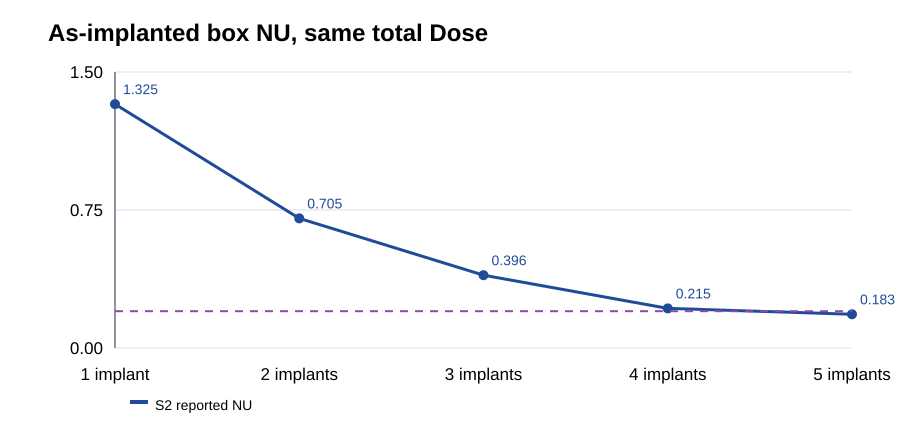

# Retrograde P-Well 지향 Box-like 프로파일 시뮬레이션

**자료 제공·정리: 박경록 팀원 / 제공일 2026-11-24**. 사용자 업로드 TCAD_run.zip을 바탕으로 문서화. ZIP의 *보고값*과 이번 대화에서 새로 실행·검증한 결과를 혼동하지 않는다.

## 문제 정의

P형 Si의 표면 **0–0.2 µm**에서는 이온주입에 의한 농도 증가를 낮게 억제하고, 깊은 영역 **0.5–1.5 µm**에서는 고농도의 평탄한 **Box-like** 분포를 만든다. 목표 농도 1×10¹⁷ cm⁻³, 초기 총 Dose 1×10¹³ cm⁻². Retrograde P-Well은 동기 사례이며 소자 구조나 전기 특성을 계산한 연구가 아니다.

## 수행 범위(업로드 자료 기준)

| 단계 | 내용 | 결과 출처 | 상태 |
|---|---|---|---|
| S0 | 400 keV B 단일 주입의 2 nm / 5 nm 격자 확인; Hsu 2002 실험 유사 레시피 재현 | 제공 ZIP 결과요약·문서 | 결과 보고됨 |
| S1 | 단일 주입 B 100–1000 keV, Rp·ΔRp·비대칭도 추출 | stage1_summary.csv | 결과 보고됨 |
| S2 | 동일 총 Dose에서 1·2·3·4회, **확장 5회** 주입 직후 비교 | summary.csv, design.json / design_n5.json | 결과 보고됨 |
| S3 | A(매회 1000°C 10s RTA) / B(최종 1회 1000°C 10s RTA) | summary.csv | 결과 보고됨 |
| S4a | C(최종 1회, n×10 s), Fermi와 ChargedPair 모델에 따른 결과 비교 | summary.csv | 결과 보고됨 |
| S4b | Furnace·장시간 열처리의 열예산 sweep | summary.csv | 결과 보고됨 |
| S5 (계획) | 4회·5회 Dose/에너지 산포 강건성, 38회 실행 구상 | 결과분석 해석 v2 | **미실행 / 예상** |

전체 수치와 모델 가정은 [조건 및 수식](conditions.md), [결과 상세](results/README.md), [후속 계획](next-steps.md), [문헌](references.md) 참조.

## 핵심 발견과 유의점

1. **주입 횟수:** 1회 1.325 → 4회 0.215 → 확장 5회 0.183(as-implanted). 단, 에너지와 개별 Dose 배분이 함께 달라져 횟수 하나만의 인과 효과는 아니다.
2. **RTA 순서:** 4회 A/B NU 0.194/0.207, 5회 A/B 0.160/0.166. 제공 자료의 사전 유의차 기준(NU차 0.02 또는 목표 대비 프로파일 최대차 5%)으로는 두 방식의 차이가 작다. A는 RTA 총 시간이 n배라는 점에 유의.
3. **열예산:** 5회 최종 RTA NU 0.166, T2(950°C 30분) 0.139, T3(1000°C 60분) 0.153, T4(1000°C 6시간) 0.213. T4에서는 표면비 0.225 → 표면 저농도 조건 미달.
4. **목표 농도 미달:** 5회 B의 box 평균 약 8.377×10¹⁶ cm⁻³. NU가 낮다고 1×10¹⁷ cm⁻³ 달성이 보증되지는 않는다.
5. **관찰 한계:** 문서에는 SIMS 원문 봉우리 위치를 참고한 모델 검증, 500→550 keV에서 ΔRp 불연속, 예측 NU와 TCAD 값 차이 등의 한계가 명시되어 있다.

## 보관 구성

- [조건·시뮬레이션 설계](conditions.md)
- [결과 요약·해석](results/README.md) / [CSV](results/comparison_metrics.csv) / [단일 에너지](results/stage1_summary.csv)
- [Sentaurus 입력 정리본](decks/README.md). ZIP에 포함된 실제 .cmd의 변수·형식을 따라 주요 run을 읽기 쉽게 다시 생성한 파일이므로 **원본 실행 파일의 바이트 단위 백업으로 해석하지 않는다**.
- [다음 단계](next-steps.md) / [출처 목록](references.md)

### 원본과의 대응

원본 ZIP 경로: TCAD_run/decks, decks2, decks3, results, figures_svisual, d1.tar, d2a.tar, ug.tar 내 d2b.tar, figs.tar, analyze.py, make_decks.py; 상위의 계획서·근거 문서·결과분석 v2·발표 PPTX·논문과 특허. 현재 GitHub는 **핵심 자료를 요약·선별한 정리본**이며 원본 ZIP 파일·모든 *.plx·*.log·원본 *.png는 포함하지 않는다.