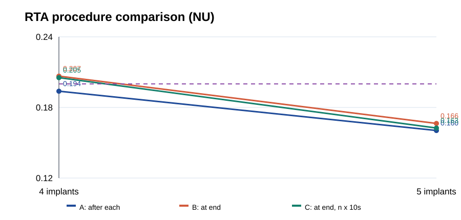

# 2026-11-24 제출 시뮬레이션 결과 정리

출처: 제공 ZIP의 TCAD_run/results/summary.csv 및 stage1_summary.csv, figures_svisual/결과요약.txt, 결과분석 해석 v2. **첨부 자료에서 보고된 Sentaurus 실행 결과**이며 이번 편집에서 TCAD를 재실행한 것은 아니다.

## S0 검증과 단일 에너지

- 400 keV, 1×10¹² cm⁻²에서 **5 nm vs 2 nm**: box 구간 최대 차이가 자료상 약 **0.01%**; 이후 신규 자료의 5 nm 채택.
- Hsu et al.(2002) 실험 조건을 모사한 계산의 고에너지 성분 피크 약 **1.54 µm / 2.31 µm**, 골 약 **1.03 µm**. 원문 SIMS의 위치 근사와 비교했으나 전체 도핑·결함 모델 정확성을 입증한 것은 아니다.
- 에너지 증가에 따라 Rp 증가: 200 keV **0.624 µm**, 400 keV **0.972 µm**, 800 keV **1.525 µm**. 참고 기준점과의 문서상 +14/+2/−3% 비교는 **피크 깊이** (0.570/0.920/1.555 µm) 기준이다. Rp와 혼동하지 않는다.
- 500→550 keV 부근에서 ΔRp가 0.2347→0.1395 µm로 불연속. 모델 테이블 경계 추정은 **미검증**.
- [S1 전체 표](stage1_summary.csv).

## S2: 동일 총 Dose·주입 횟수 1~5회 (As-implanted)

| 회수 | 순서별 에너지 (keV) | NU | NU_inner | 표면비 | box 평균 (cm⁻³) | NU 통과 |
|---:|---|---:|---:|---:|---:|:--:|
| 1 | 400 | 1.3254 | 1.0516 | 0.0106 | 9.769×10¹⁶ | X |
| 2 | 500/200 | 0.7045 | 0.6714 | 0.0434 | 8.464×10¹⁶ | X |
| 3 | 700/500/200 | 0.3957 | 0.4018 | 0.0343 | 8.421×10¹⁶ | X |
| 4 | 700/500/300/200 | 0.2153 | 0.2118 | 0.0300 | 8.682×10¹⁶ | X |
| **5 (확장)** | **750/600/450/300/200** | **0.1833** | 0.1751 | 0.0303 | 8.397×10¹⁶ | **O** |

주입 횟수가 증가할수록 여기서 선택된 에너지·Dose 조합에서는 평탄해졌으나, n만의 독립 효과로 일반화할 수 없다. 표면비는 모든 S2 run에서 자체 기준 충족.

## S3/S4a: A·B·C 비교

| n | 매회 RTA A NU | 최종 1회 B NU | 동일 총 시간 C NU | A−B ΔNU |
|---:|---:|---:|---:|---:|
| 2 | 0.6754 | 0.6845 | 0.6832 | 0.0091 |
| 3 | 0.3601 | 0.3744 | 0.3717 | 0.0143 |
| 4 | 0.1938 | 0.2066 | 0.2053 | 0.0128 |
| **5 (확장)** | **0.1604** | **0.1664** | **0.1625** | **0.0060** |

- 제공 결과요약이 기록한 프로파일 A/B 최대 차이는 n=3~5에서 약 2.3~2.6%. NU 차이는 모두 0.02 미만.
- n=4의 A는 0.1938(통과), B는 0.2066(미통과)이나, **사전에 정한 유의차 기준**에는 못 미친다. 이 사실을 빼고 '완전히 동일'이라고 표현하지 않는다.
- n=5 B의 표면비 **0.0308**이므로 NU·표면비 기준 통과. **box 평균 8.377×10¹⁶ cm⁻³**로 목표값에는 미달.
- TED 비교(n=4): 기본 모델 A 0.1938/B 0.2066, Fermi 비교 A 0.1958/B 0.2146. 제공 자료는 프로파일 차이를 약 3.1~3.2%로 보고했고, '0'이라고 하지 않는다.

## S4b: 열예산과 평탄도·표면 저농도 trade-off

| 열처리 | n=4 NU | n=5 NU | n=5 표면비 |
|---|---:|---:|---:|
| B, 1000°C 10 s RTA | 0.2066 | 0.1664 | 0.0308 |
| T2, 950°C 30 min | 0.1930 | 0.1385 | 0.0336 |
| T3, 1000°C 60 min | 0.2027 | 0.1527 | 0.0573 |
| T4, 1000°C 6 h | 0.2283 | 0.2132 | **0.2254 (표면비 불합격)** |
| 각 주입 후 furnace 950°C 30 min | 0.1987 | 0.1412 | 0.0325 |

문서상 확산 길이 근사: B 7nm, T2 49nm, T3 137nm, T4 335nm. T3는 box 안쪽 구간의 NU_inner를 낮추더라도 box 경계와 표면으로 확산하면서 전체 NU나 표면비가 악화될 수 있다. 1회 주입은 T4 후에도 NU **0.5560**으로 미통과.

## 결론(해당 수치가 말하는 범위)

- 이 레시피·모델·자체 합격선에서는 **5회 + 최종 1회 RTA**가 NU·표면비를 만족하고 주입마다 RTA보다 열처리 단계 수가 적다.
- 이 결과는 전체 웰 공정의 보편적 최적, 공정 비용의 정량 최소, 목표 평균 농도 달성 또는 MOSFET 특성 최적화를 뜻하지 않는다.
- 추가 입증 필요: 목표 평균 농도에 맞춘 dose scaling 뒤 검증, dose/energy 산포 민감도, 500–550 keV 분포 모델 불연속 및 실제 원본 로그 확인.

[주요 지표 CSV](comparison_metrics.csv) · [열처리 CSV](thermal_metrics.csv) · [원본 그림 대조표](figure_index.md).