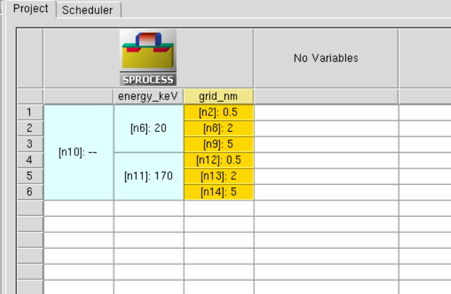
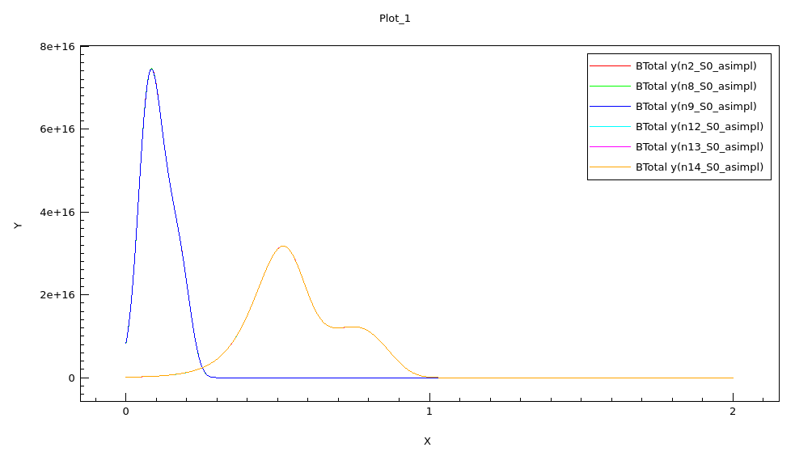

# SIM-000 — Grid 수렴성 검증 및 기준 격자 선정

> **2026-11-23 / 상태:** 1차·2차 Sentaurus Process 이온주입 시뮬레이션 **완료**, 실제 출력 데이터에 근거해 **as-implanted 분석용 기준 Grid = 2 nm 선정**. **RTA 확산 수렴성은 아직 미검증.** 본 문서의 "확정"은 **본 프로젝트의 현재 이온주입 단계에 사용할 설정값**이라는 뜻이며, 2 nm가 모든 공정에서 수학적으로 최적·절대 수렴한 격자라는 뜻은 아니다.

## 1. 목적

평판 (100) Si 기판에 Boron을 **단일 에너지로 이온주입**할 때 깊이 방향 Grid 간격이 **BTotal 농도 프로파일**의 피크 농도·위치, 평균 농도, 분포 모멘트 및 데이터 보간 오차에 미치는 영향을 검증하고, 후속 **1~4회 다중 에너지 이온주입** 시뮬레이션의 기준 격자를 정한다. **목표 깊이 0.05~0.45 µm**를 주요 관심 구간으로 두되, **170 keV 피크가 약 0.518 µm**에 위치하므로 분포 비교에는 **0~0.8 µm** 구간도 함께 사용했다.

> 이 실험은 Box-like Profile 형성이나 RTA를 직접 수행한 실험이 아니다. Retrograde well이나 MOSFET 결과를 검증한 것도 아니다.

## 2. 두 차수의 구성과 실제 조건

| 항목 | 1차: 80 keV | 2차: 20/170 keV |
|---|---|---|
| 역할 | Grid 후보 선별, 80 keV 농도 수렴성 확인 | 얕은·깊은 주입에서도 후보 Grid 검증 및 **최종 설정 선정** |
| 이온/기판 | B / (100) Si, n형 P 1×10¹⁵ cm⁻³ | 1차와 동일 |
| Dose | 1×10¹² cm⁻² | 동일 |
| Tilt / Rotation | 7° / 22° | 동일 |
| Energy | **80 keV** | **20 keV, 170 keV** |
| Grid 간격 (0~0.8 µm) | **0.5, 1, 2, 5 nm** | **0.5, 2, 5 nm** |
| RTA | 없음 (as-implanted) | 없음 |
| 실행 환경 | Sentaurus Workbench / Process / Visual T-2022.03 | 동일 계열 |
| 결과·자료 | [1차 상세 기록](run-01_80keV/README.md) | [2차 상세 기록](run-02_20_170keV/README.md) · [사용자 제공 Workbench 화면](run-02_20_170keV/results/workbench.png) · [BTotal 중첩 그래프](run-02_20_170keV/results/2nd_grid_convergence.png) |

공통 깊이 범위는 **Si 0~2 µm**이며, **0~0.8 µm**에서 각 후보 Grid를 비교하고 **1.2 µm 10 nm / 2.0 µm 20 nm**로 이후 간격을 완만히 증가시키는 구조다. 2차는 1 nm를 제외했으며, 1차의 1 nm 데이터는 원본에 보존했다.

### 2차 실행 화면 — 사용자 제공 원본

다음 두 이미지는 **2026-11-23에 실제 수행한 2차 SWB 설정 화면과 Sentaurus Visual 농도 중첩 그래프**다. 원본 PNG를 변형 없이 보존했으며, 이 화면 자체만으로 오차를 판정하지 않고 아래 CSV 기반 정량 지표를 함께 확인한다.

**Workbench: Energy 20/170 keV × Grid 0.5/2/5 nm → 총 6개 실험**



**Sentaurus Visual: 6개 BTotal 깊이별 농도 프로파일 중첩**



20 keV의 얕은 피크와 170 keV의 상대적으로 깊은 피크는 구분되지만, **같은 에너지 안에서는 Grid별 곡선이 거의 겹친다**. 이것이 바로 2 nm를 선택한 정량 비교의 출발점이다. [2차 원본 CSV](run-02_20_170keV/results/2nd_grid_convergence.csv)와 [상세 기록](run-02_20_170keV/README.md)을 함께 참고한다.

## 3. 평가 및 비교 방법

- **기준:** 에너지별 **0.5 nm 출력 프로파일**(잠정 Reference). 0.5 nm 자체의 절대 수렴성을 검증한 것은 아님.
- **피크 오차:** `|C_peak(grid)−C_peak(0.5)| / C_peak(0.5) × 100%`.
- **피크 깊이 차이:** 각 CSV 샘플에서 읽은 최대값 위치의 차이(nm). 샘플 간격 영향이 포함되므로 물리적 위치 이동이라고 단정하지 않음.
- **곡선 오차:** 공통 깊이 좌표(간격 **0.0005 µm = 0.5 nm**)에 **선형 보간**한 뒤 `NRMSE = sqrt(mean((C_grid−C_ref)^2)) / max(C_ref) × 100%`.
- **보조 기준:** 평균 농도·적분 Dose·모멘트 **Rp·ΔRp**. Rp는 출력 BTotal의 평균 깊이로, 피크 위치와 다름.
- **잠정 허용 기준:** 피크 농도 ≤1%, **표본 피크 위치 차이 ≤1 nm**, NRMSE ≤2%, 관심구간 평균농도 ≤1%. 이는 프로젝트 내 선택용 기준으로 공식 TCAD 규격이 아님.

## 4. 1·2차 종합 비교: 0.5 nm 기준 대비

### A. 피크 농도와 피크 위치

| Energy | 기준 피크 농도 (cm⁻³) | 기준 피크 깊이 (µm) | 2 nm 피크 오차 | 2 nm 깊이 차이 | 5 nm 피크 오차 | 5 nm 깊이 차이 |
|---:|---:|---:|---:|---:|---:|---:|
| **20 keV** | 7.459735×10¹⁶ | 0.0840 | **0.000000%** | **0 nm** | 0.017842% | +1.0 nm |
| **80 keV** (1차) | 3.483489×10¹⁶ | 0.2975 | **0.000718%** | **+0.5 nm** | 0.038094% | **+2.5 nm** |
| **170 keV** | 3.179637×10¹⁶ | 0.5180 | **0.000000%** | **0 nm** | 0.032897% | **+2.0 nm** |

표의 0.000000%는 **CSV에 저장된 피크 농도값이 기준과 일치**했다는 뜻이지, 무한정밀하게 오차가 0이라는 주장은 아니다. 5 nm의 80/170 keV 표본 피크 위치는 잠정 기준(1 nm)을 벗어났고, 이는 더 성긴 표본의 **피크 샘플링 편차**일 수 있다.

### B. 전체 농도 곡선 오차 — **0~0.8 µm** 공통 영역

| Energy | 2 nm 정규화 RMSE | 2 nm 최대 정규화 농도 차이 | 5 nm 정규화 RMSE | 5 nm 최대 정규화 농도 차이 |
|---:|---:|---:|---:|---:|
| 20 keV | **0.004781%** | **0.026750%** | 0.029912% | 0.166172% |
| 80 keV | **0.001886%** | **0.007062%** | 0.011807% | 0.044065% |
| 170 keV | **0.001779%** | **0.006966%** | 0.011132% | 0.043464% |

정규화 분모는 **각 에너지의 0.5 nm 기준 피크 농도**다. 이 표는 **0~0.8 µm** 범위이므로, 1차 상세 기록의 **0.05~0.45 µm** 범위 NRMSE와 숫자가 다를 수 있다. **170 keV에서는 피크가 관심 구간 밖에 있으므로** 확장 비교가 특히 중요하다. 0.8~2.0 µm의 출력 데이터도 보존되어 있지만, 해당 깊이에서는 Grid 간격이 점차 커진다.

### C. 평균 농도·Dose 일관성 및 데이터 해상도

| 지표 | 2 nm | 5 nm | 해석 |
|---|---|---|---|
| 0.05~0.45 µm 평균 농도 상대차 (20 keV) | −0.004075% | −0.026905% | 두 조건 모두 작음 |
| 0.05~0.45 µm 평균 농도 상대차 (80 keV) | −0.000254% | −0.001678% | 두 조건 모두 작음 |
| 0.05~0.45 µm 평균 농도 상대차 (170 keV) | +0.002533% | +0.016731% | 두 조건 모두 작음 |
| 0~2 µm 적분 Dose 기준 대비 최대 상대오차(3 에너지 중) | **약 0.00121%** | **약 0.00799%** | 출력 농도 적분의 차이이며 실제 주입 Dose 설정 변경은 없음 |
| 0.05~0.45 µm TDR XY 좌표 점 개수(1차) | **201개** | **81개** | 0.5 nm 기준은 801개 |

**관찰과 해석을 구분하면**, 출력 프로파일에서 2 nm와 5 nm의 농도 오차는 모두 작다. 다만 2 nm가 피크 깊이를 더 촘촘히 샘플링하고 세 에너지에서 표본 피크 위치의 잠정 허용 기준을 일관되게 충족한다. 출력 점 개수는 실제 계산 메모리·시간 그 자체가 아니므로 계산 비용 절감을 **실측했다고 주장하지 않는다**.

## 5. 최종 Grid 설정 결과 — **2 nm (as-implanted 기준)**

**선정값:** **0~0.80 µm → 2 nm**, 이후 **1.20 µm → 10 nm**, **2.00 µm → 20 nm**로 점진적 확장.

선정 이유: **20·80·170 keV**에서 0.5 nm 기준 대비 2 nm의 피크 농도 오차는 **최대 0.000718%**, 표본 피크 위치 차이는 **최대 0.5 nm**, 0~0.8 µm NRMSE는 **최대 0.004781%**였다. 5 nm도 농도 프로파일은 유사하지만, 표본 피크 깊이 차이는 두 에너지에서 1 nm를 초과했다. 이에 따라 **1차 1 nm 결과를 포함하여**, 필요한 분포 해상도와 표본 수를 고려해 후속 **주입 직후 단일·다중 에너지 연구의 실무용 Grid = 2 nm로 결정한다.**

**재사용용 설정 블록:** [`grid_2nm_mesh.inc`](grid_2nm_mesh.inc). 이 파일은 기존 Sentaurus Process 덱의 Grid 부분에 넣을 **참조 블록**이며 별도 전체 실행 덱이 아니다.

```tcl
line x location=0.00<um> spacing=2<nm> tag=SiTop
line x location=0.05<um> spacing=2<nm>
line x location=0.25<um> spacing=2<nm>
line x location=0.45<um> spacing=2<nm>
line x location=0.80<um> spacing=2<nm>
line x location=1.20<um> spacing=10<nm>
line x location=2.00<um> spacing=20<nm> tag=SiBottom
region Silicon xlo=SiTop xhi=SiBottom
```

**적용 범위와 한계:** 이 결정은 **현재의 단일 B 주입 모델, Dose 및 주입각 조건, as-implanted BTotal 출력에 근거**한다. 모델·이온종·주입각·총 Dose·깊이 범위가 크게 바뀌거나 **RTA 확산·활성화**를 수행하면 추가 Grid 민감도 검증이 필요하다. 0.25 nm 같은 더 촘촘한 절대 수렴 검증, 내부 원본 TDR 토폴로지, 실제 CPU 시간·메모리 측정은 수행하지 않았다. 5 nm를 전반적으로 부정확한 격자라고 판정하지 않는다.

## 6. 폴더·원자료

```text
simulations/sim-000/
├── README.md                     # 이 문서: 목적·두 차수 종합 결과·최종 Grid
├── grid_2nm_mesh.inc             # 선정된 Grid 설정 블록(참조용)
├── run-01_80keV/
│   ├── README.md                 # 1차 실행 기록·물리적 해석
│   ├── sprocess_fps.cmd          # 1차 실제 입력 코드
│   └── results/                 # CSV 3종 + 실제 사용자 제공 Workbench/S-Visual 이미지
└── run-02_20_170keV/
    ├── README.md                 # 2차 실행 기록·오류 수정 이력·비교 분석
    ├── sprocess_fps.cmd          # 사용자 제공 2차 입력 코드
    └── results/
        ├── 2nd_grid_convergence.csv  # 2차 실제 XY 내보내기
        ├── convergence_metrics.csv   # 2차 정량 계산 지표
        ├── workbench.png             # SWB 파라미터 설정 원본 화면
        └── 2nd_grid_convergence.png  # S-Visual BTotal 중첩 원본 그래프
```

- **1차 기록/원자료:** [실행 및 세부 분석](run-01_80keV/README.md), [원본 PLX CSV](run-01_80keV/results/grid_convergence.csv), [TDR XY CSV](run-01_80keV/results/mesh_TDR.csv), [중첩 그래프](run-01_80keV/results/grid_convergence_user.webp), [Workbench 설정](run-01_80keV/results/workbench_user.webp).
- **2차 기록/원자료:** [실행 및 세부 분석](run-02_20_170keV/README.md), [사용자 제공 명령어 파일](run-02_20_170keV/sprocess_fps.cmd), [원본 CSV](run-02_20_170keV/results/2nd_grid_convergence.csv), [비교 지표 CSV](run-02_20_170keV/results/convergence_metrics.csv), [Workbench 화면](run-02_20_170keV/results/workbench.png), [중첩 그래프](run-02_20_170keV/results/2nd_grid_convergence.png).

**기록 원칙:** 1차 원본 및 상세 기록은 새 폴더로 이동만 하고 기존 수치를 임의 수정하지 않았다. **2차 사용자 제공 `.cmd`·CSV·Workbench/그래프 PNG 파일은 2026-11-23에 추가 제공되어 보존**했다. `.cmd`는 제공된 입력 덱 파일이며, 실행 로그·TDR 바이너리는 여전히 GitHub에 미첨부이다. 실제 실행 완료 상태는 사용자 확인과 제공된 CSV에 근거한다.
