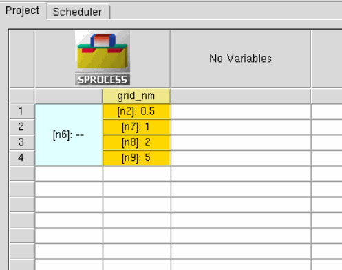
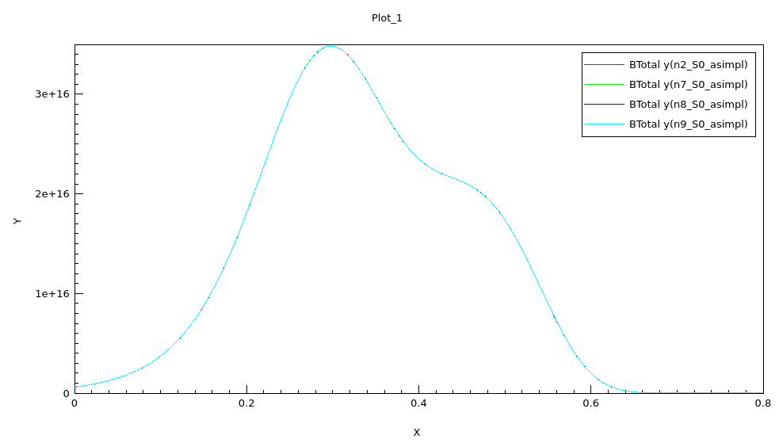

# SIM-000 — Grid 수렴성 검증 (Sentaurus Process)

> **진행 상태 (2026-11-23):** 1차(80 keV 단일 주입, 0.5/1/2/5 nm) **실행·분석 완료**. SIM-000 전체 Grid 조건의 최종 확정은 **미완료**.

## 목적
평판 Si 기판의 깊이 방향 격자 설정을 변화시키고, 이온주입 후 **Boron Total (BTotal) 농도 프로파일**이 격자에 대해 얼마나 민감한지 확인한다. 목표 깊이 **0.05~0.45 µm**에서의 프로파일 오차와 피크 농도·위치·분포 모멘트를 비교해, 후속 단일/다중 에너지 주입에 사용할 **계산 효율적인 격자 후보**를 검토한다.

## 검증 방법
1. 기판·주입 조건을 고정하고 **grid_nm = 0.5, 1, 2, 5**만 변경한 Sentaurus Workbench parameter sweep을 실행한다.
2. 생성된 **BTotal vs. depth** 데이터를 공통 깊이 좌표에 보간하여 가장 촘촘한 **0.5 nm를 잠정 기준**으로 오차를 비교한다.
3. 피크 농도 및 피크 깊이, 적분 모멘트 기반 **Rp/ΔRp**, 관심 구간 평균 농도, 정규화 RMSE·최대 차이 및 적분 Dose를 확인한다.
4. 수렴 오차와 계산 비용(실제 mesh 노드 수·실행 시간)을 함께 검토한 뒤 격자 후보를 선택한다.

> **해석 범위:** 0.5 nm가 절대적인 수렴 해라는 증거는 아니며, 현재 결과는 **80 keV의 RTA 이전(as-implanted) 단일 주입**에 한정된다. 각 명령의 spacing은 지정 위치의 국소 간격 설정값이다. 실제 TDR mesh·다른 주입 에너지·RTA 확산 수렴성은 별도 확인해야 한다.

## 실험 진행 현황

| 차수 | 목적 | 조건 | 상태 |
| --- | --- | --- | --- |
| **1차** | 기본 Grid sweep | **Boron 80 keV / 1×10¹² cm⁻²**, 0.5·1·2·5 nm | **완료** |
| 후속 | 얕은·깊은 주입 검증 | 20 keV 및 170 keV 등 **후보** | 미실행 |
| 후속 | 실제 Mesh/비용 및 RTA 적용 검토 | TDR, 노드 수, 실행 시간, 필요시 확산 Grid 검사 | 미실행 |

## 파일 안내

- **[1차 실행 과정·결과·해석](run-01_80keV.md)** — 실험 수행 순서, 실제 조건, 수치 비교, 한계와 다음 할 일.
- **[실제 실행에 사용한 Workbench 입력 코드](sprocess_fps.cmd)** — 사용자 제공 SPROCESS 입력 파일 원본 텍스트.
- **[1차 원본 CSV 데이터](results/grid_convergence.csv)** — Sentaurus Visual에서 내보낸 네 가지 프로파일의 X/Y 데이터.
- **[Grid별 수렴성 지표](results/convergence_metrics.csv)** — 원본 CSV에서 재계산한 비교값.
- **[사용자 제공 BTotal 중첩 그래프](results/grid_convergence_user.webp)** — 실제 Sentaurus Visual 결과 화면(웹 표시용 WebP 변환).
- **[사용자 제공 Workbench 파라미터 설정 화면](results/workbench_user.webp)** — grid_nm과 4개 실험 노드(웹 표시용 WebP 변환).

### 범위 구분
이 실험은 프로젝트의 주입 횟수 1~4회 비교 및 RTA Case A/B **전에 수행하는 기초 격자 검토**다. 여기의 80 keV, 1×10¹² cm⁻², (100) Si, B 이온 등의 조건은 **SIM-000 1차 실험의 실제 적용값**이지 후속 연구 전체의 최종 확정값이 아니다.

## 1차 실험 화면 기록 (사용자 제공)

### 4개 Grid 조건이 설정된 Workbench

### Sentaurus Visual의 BTotal 중첩 그래프

위 두 이미지는 **실제 사용자가 업로드한 실행 화면**을 GitHub 웹 표시용으로 변환하여 보관한 것이다. CSV 기반 재작성 그래프와 구분한다.
