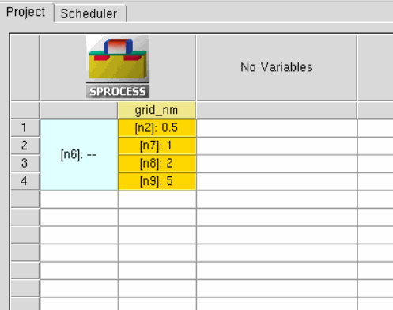
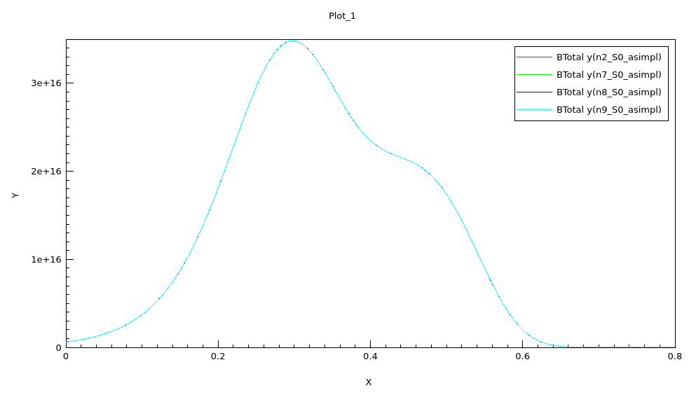

# SIM-000 / 1차 — 80 keV 단일 주입의 Grid 수렴성 비교

- **수행일:** 2026-11-23
- **상태:** 4개 조건 Sentaurus Workbench 실행 완료(done); .plx 프로파일 확인 및 CSV 정량 비교 완료.
- **실행 환경:** Sentaurus Workbench / Sentaurus Process / Sentaurus Visual **T-2022.03**
- **서버 작업 디렉터리(실제 실행):** /user2/tcad/tcad411/gangmin/grid_nm
- **데이터 출처:** 사용자가 제공한 실제 SPROCESS 명령 파일, Workbench/S-Visual 화면, S-Visual의 grid_convergence.csv. GitHub에 저장된 원본 코드는 [sprocess_fps.cmd](sprocess_fps.cmd), 데이터는 [results/grid_convergence.csv](results/grid_convergence.csv) 참고.

## 1. 목적과 비교 원칙
**80 keV 단일 B 주입에서 깊이 방향 Grid 간격만 바꾸었을 때 농도 곡선의 수치적 차이**를 확인한다. 현재 비교는 아직 Box-like 형성이 아니라 후속 이온주입 조건을 계산하기 위한 사전 Grid 검증이다.

- **독립변수:** Grid 설정 파라미터 grid_nm (0.5 / 1 / 2 / 5 nm)
- **고정변수:** 이온·기판·Energy·Dose·입사각·RTA 미실시.
- **관심 깊이:** 0.05~0.45 µm (팀 최종 확정 전의 실험 제안 구간)
- **평가 구간:** 0.05~0.45 µm. 그래프 표시 구간은 0~0.80 µm.

## 2. 실제 입력 조건

| 항목 | 적용 값 |
| --- | --- |
| 기판 | 1D 평판 Silicon, 깊이 0~2.00 µm |
| 결정방향 | Si (100), init wafer.orient=100 |
| 초기 도핑 | Phosphorus 1×10¹⁵ cm⁻³ (n형) |
| 주입종 | Boron |
| Energy / Dose | **80 keV / 1×10¹² cm⁻²** |
| Tilt / Rotation | 7° / 22° |
| RTA | **미수행** (as-implanted) |
| 출력 | SetPlxList {BTotal}, WritePlx, struct tdr |
| Grid 지정점 | x=0 / 0.05 / 0.25 / 0.45 / 0.80 µm에서 grid_nm; x=1.20 µm에서 10 nm, x=2.00 µm에서 20 nm |

**주의:** Grid의 spacing 값은 지정점의 국소 격자 간격이다. 0~0.80 µm 내 실제 모든 Mesh 셀의 크기가 정확히 그 값이라는 별도의 TDR 검증은 아직 수행하지 않았다.

| Workbench Node | grid_nm |
| --- | ---: |
| n2 | 0.5 nm |
| n7 | 1 nm |
| n8 | 2 nm |
| n9 | 5 nm |

## 3. 실제 수행 과정

### Workbench에서 설정한 4개 Grid 파라미터

*노드 n2=0.5 nm, n7=1 nm, n8=2 nm, n9=5 nm. 사용자가 업로드한 Workbench 화면을 웹 게시용으로 변환한 이미지다.*

1. Traditional SWB 프로젝트 grid_nm에서 SPROCESS 명령어 파일 **sprocess_fps.cmd**를 작성했다.
2. 지역/기판 초기화 → Boron implant → BTotal .plx와 구조 .tdr 저장 명령을 구성했다.
3. Workbench에 **grid_nm 파라미터(0.5, 1, 2, 5)**를 추가하여 4개 노드를 생성했다.
4. 각 노드의 parameter 치환을 확인하고, **Preprocess, then run**으로 네 조건을 일괄 실행했다.
5. Workbench에서 네 노드 모두 **done** 상태를 확인했다.
6. Sentaurus Visual에서 네 개 .plx 파일의 BTotal 곡선을 중첩하고 x=0~0.80 µm 범위를 확인했다.
7. **Export XY Data**로 네 곡선을 CSV로 추출한 뒤 수렴성 지표를 계산했다.

> **재현 가능 자료:** 실제 입력 [.cmd](sprocess_fps.cmd), 원본 [CSV](results/grid_convergence.csv). TCAD 서버의 .plx, .tdr, 상세 로그, 실행 시간/실제 Mesh 노드 수는 이번 GitHub 기록에 첨부되지 않았다. 순차/동시 실행 세부 자원 설정은 로그로 검증하지 않았다.

## 4. 그래프 및 정량 결과

*위 이미지는 사용자가 제공한 **실제 Sentaurus Visual 중첩 그래프 화면**이다(웹 게시용 WebP 변환). 네 농도 곡선은 표시 축 범위에서 거의 중첩된다.*

| Grid | Peak BTotal (cm⁻³) | Peak 위치 (µm) | Peak 상대오차† | 피크 위치 차이† |
| --- | ---: | ---: | ---: | ---: |
| **0.5 nm** | **3.483489×10¹⁶** | **0.2975** | 기준 | 기준 |
| 1 nm | 3.483464×10¹⁶ | 0.2980 | **0.000718%** | 0.5 nm |
| 2 nm | 3.483464×10¹⁶ | 0.2980 | **0.000718%** | 0.5 nm |
| 5 nm | 3.482162×10¹⁶ | 0.3000 | **0.038094%** | 2.5 nm |

† 0.5 nm의 **표본 피크**를 기준으로 비교.

### 관심구간 (0.05~0.45 µm) 프로파일 오차

| Grid | 정규화 RMSE‡ | 최대 절대농도 차이 / 기준 피크 | 구간 평균 BTotal (cm⁻³) |
| --- | ---: | ---: | ---: |
| 0.5 nm | 기준 | 기준 | 2.0003738×10¹⁶ |
| 1 nm | 0.000565% | 0.001780% | 2.0003728×10¹⁶ |
| 2 nm | 0.002329% | 0.007062% | 2.0003687×10¹⁶ |
| 5 nm | 0.014583% | 0.044065% | 2.0003402×10¹⁶ |

‡ 원본 CSV의 각 조건을 **0.0005 µm 간격의 공통 깊이 좌표**에 선형 보간해 비교. NRMSE = sqrt(mean((C_grid−C_0.5)²)) / max(C_0.5) ×100. 최대 차이도 같은 피크 농도로 정규화한다. 값은 원본 CSV에서 재계산했으며 계산/반올림 방법 차이에 따라 이전 대화의 근삿값과 소폭 다를 수 있다.

### 분포 모멘트와 주입 Dose 검산

| Grid | 적분 모멘트 Rp (µm) | 적분 모멘트 ΔRp (µm) | 적분된 총 B Dose (cm⁻²) |
| --- | ---: | ---: | ---: |
| 0.5 nm | 0.33769750 | 0.11585596 | 약 1.000000×10¹² |
| 1 nm | 0.33769752 | 0.11585594 | 약 1.000000×10¹² |
| 2 nm | 0.33769760 | 0.11585587 | 약 1.000000×10¹² |
| 5 nm | 0.33769814 | 0.11585535 | 약 0.999998×10¹² |

- Rp = ∫xC(x)dx / ∫C(x)dx, ΔRp = sqrt(∫(x−Rp)²C(x)dx / ∫C(x)dx). **0~2 µm 출력 데이터**의 사다리꼴 적분으로 계산했다. 이는 도핑 프로파일의 **모멘트 기반 근삿값**이며 TCAD 내부 주입 모델이 보고하는 Rp·straggle 파라미터와 반드시 동일하다는 뜻은 아니다.
- Peak 위치 약 0.298 µm와 Rp 약 0.338 µm는 다르며, 비대칭 도핑 분포의 영향을 반영한다.

## 5. 결과 해석과 판단

**관찰:** 네 Grid 조건 모두 피크 농도·프로파일이 매우 비슷했다. 가장 성긴 5 nm조차 0.5 nm 대비 정규화 RMSE 약 **0.0146%**, 최대 농도 차이 약 **0.0441%**이다. 5 nm의 표본 피크 깊이는 2.5 nm 다르다.

**해석(가능성):** 동일 깊이의 농도값이 거의 같고 피크 깊이는 표본 위치에 영향을 받으므로, 현재 선택한 **as-implanted 주입 프로파일 출력이 격자 간격에 둔감**할 가능성이 있다. 다만 이것만으로 실제 물리 모델의 완전한 수치 수렴이나 RTA 확산 수렴을 증명할 수 없다.

**잠정 결론:** 이 80 keV 조건의 **출력 프로파일 비교만으로는** 0.5~5 nm 전체가 매우 유사하다. 후속 작업에 **2 nm를 초기 실무 후보**로 제안하되, 5 nm를 배제하거나 2 nm가 최적이라고 최종 판정하지 않는다. 실제 mesh 노드 수·계산시간 및 20/170 keV 등 다른 에너지 검증이 필요하다.

**미확인/한계**
- 실제 .tdr 기반 mesh 크기 분포, 노드 수, 실행시간·메모리 측정 없음.
- 0.5 nm 자체에 대한 더 촘촘한 기준 (예: 0.25 nm) 비교 없음.
- 주입 모델의 수치적/경험적 적용 형태를 따로 검증하지 않음.
- RTA, 확산·활성화에 대한 Grid 민감도는 본 실험 범위 밖.
- 목표 농도 1×10¹⁷ cm⁻³에 도달하는지 검증하는 실험이 아님. 여기서는 Dose 1×10¹² cm⁻²로 **Grid만 비교**했다.

## 6. 후속 계획 (미실행)
- 20 keV 및 170 keV 등 에너지 양 끝단에서 선정 후보 Grid의 민감도 검증.
- 실제 TDR mesh 확인 및 계산 비용 기록.
- 필요 시 RTA 확산 과정에 대한 별도의 Grid 검증.
- 검증 후 후속 SIM-001/다중 에너지 연구에 사용할 기준 격자 확정.

## 데이터 파일
- [원본 CSV — grid_convergence.csv](results/grid_convergence.csv)
- [비교 지표 CSV — convergence_metrics.csv](results/convergence_metrics.csv)
- [실제 S-Visual 중첩 화면 — grid_convergence_user.webp](results/grid_convergence_user.webp)
- [실제 Workbench 파라미터 화면 — workbench_user.webp](results/workbench_user.webp)
- [실제 명령어 — sprocess_fps.cmd](sprocess_fps.cmd)
